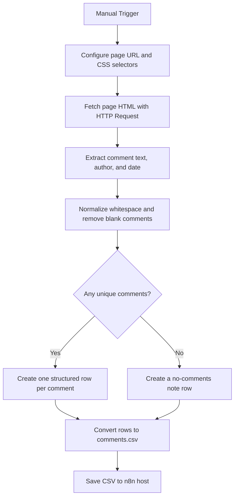

# Website Comment Extractor

An n8n workflow that fetches a configured web page, extracts comments and their metadata with CSS selectors, removes blank and duplicate comment text, and writes the result to CSV.

## Workflow illustration



## How it works

1. Start the workflow manually.
2. In the Config node, set the page URL and CSS selectors for comment text, author, and date.
3. Fetch Page downloads the page as text and sends a User-Agent header.
4. Extract Comments reads matching elements with the configured selectors.
5. Clean & Structure normalizes whitespace, skips empty comments, and removes duplicate comment text. It creates one output row per unique comment with the source URL and extraction timestamp. Author and date are included when matching values are available.
6. If no usable comments are found, the workflow creates a note row explaining that the selectors may need checking or that comments may require JavaScript rendering.
7. Convert to CSV creates `comments.csv`, then Save CSV File writes it to `/home/node/.n8n-files/comments.csv` on the n8n host.

## Configure

The example URL and selectors in the Config node are placeholders:

```text
url: https://example.com/blog-post
comment_selector: .comment-content
author_selector: .comment-author
date_selector: .comment-date
```

Replace these values with the target page URL and selectors that match its HTML. The selector for each field should identify corresponding elements in the same order so text, authors, and dates align by index.

The output CSV includes `source_url`, `author`, `date`, `comment`, and `extracted_at`. When no comments are found, it instead writes a note row with `source_url`, an empty `comment`, and `note`.

## Import and run

1. Import [comment-extractor-workflow.json](comment-extractor-workflow.json) into n8n.
2. Update the URL and selectors in Config.
3. Make sure `/home/node/.n8n-files/` exists on the n8n host and is permitted by your n8n file-access policy. Change the Save CSV File path if needed.
4. Run the workflow manually and inspect the output at `/home/node/.n8n-files/comments.csv`.

This workflow fetches the server-returned HTML; it does not run page JavaScript. If the comments are inserted dynamically in a browser, this workflow may find none. Respect the site’s terms, robots policy, copyright, and privacy requirements, and use only pages you are authorized to access.
